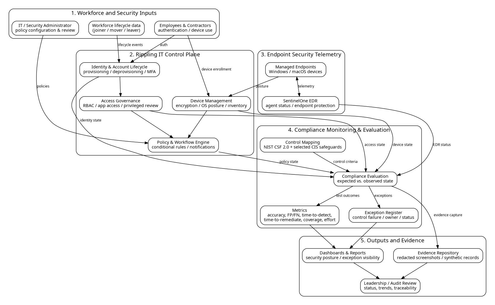

# Cybersecurity Compliance Monitoring Framework Using Rippling IT

MSIT 5910 capstone project demonstrating a lightweight, testable framework for evaluating selected identity, access, device, endpoint, and policy controls.

> **Portfolio note:** This repository contains synthetic and sanitized academic artifacts only. It does not include production employee records, credentials, confidential security configurations, or live security telemetry.

## Problem

Small organizations often verify cybersecurity controls across multiple systems. That can make evidence fragmented, reviews inconsistent, and exception tracking unnecessarily manual.

## Solution

The project uses a five-layer design:

1. Workforce and security inputs
2. Rippling IT control plane
3. Endpoint-security telemetry, including SentinelOne status where available
4. Explicit rule-based compliance evaluation
5. Evidence storage and reporting



## Technologies

- Python 3.12
- SQLite
- PyTest and pytest-cov
- Git and GitHub
- GitHub Actions
- NIST Cybersecurity Framework 2.0 as an organizing reference

## Key Features

- Ten representative cybersecurity controls
- Synthetic compliant and exception scenarios
- Rule normalization and classification
- SQLite evidence persistence
- Service-layer validation
- Unit, integration, system, and acceptance tests
- Automated CI validation
- Privacy-aware portfolio documentation

## Controlled Results

| Metric | Result |
|---|---:|
| Controlled scenarios | 20 |
| Correct classifications | 20 |
| Accuracy | 100% |
| Exception detection rate | 100% |
| False positives | 0 |
| False negatives | 0 |

These values describe the synthetic academic test set and are **not** a claim of production-security effectiveness.

## Repository Guide

- [Professional portfolio index](PORTFOLIO.md)
- [Project overview](docs/project-overview.md)
- [Architecture diagram](architecture.png)
- [Core evaluator](src/compliance_evaluator.py)
- [Integrated service layer](src/service.py)
- [SQLite evidence store](src/database.py)
- [Synthetic scenarios](tests/sample_scenarios.csv)
- [Automated tests](tests/)
- [Testing and results](docs/testing-and-results.md)
- [Results summary](results/README.md)
- [Security and privacy](docs/security-and-privacy.md)
- [Deployment and maintenance](docs/deployment-and-maintenance.md)
- [Prototype workflow visual](screenshots/prototype-workflow.svg)
- [Demo walkthrough](demo/README.md)
- [Capstone report portfolio summary](reports/capstone-report-summary.md)

## Run Locally

```bash
python -m venv .venv
source .venv/bin/activate   # Windows: .venv\Scripts\activate
python -m pip install pytest pytest-cov
python -m pytest -q --cov=src --cov-report=term-missing --cov-fail-under=100
python run_demo.py
```

## Scope and Limitations

This is an academic prototype. It does not perform penetration testing, production exploitation, certification, or unrestricted monitoring. Future work includes authorized vendor adapters, broader control coverage, authenticated multi-user access, richer reporting, and longitudinal evaluation.
